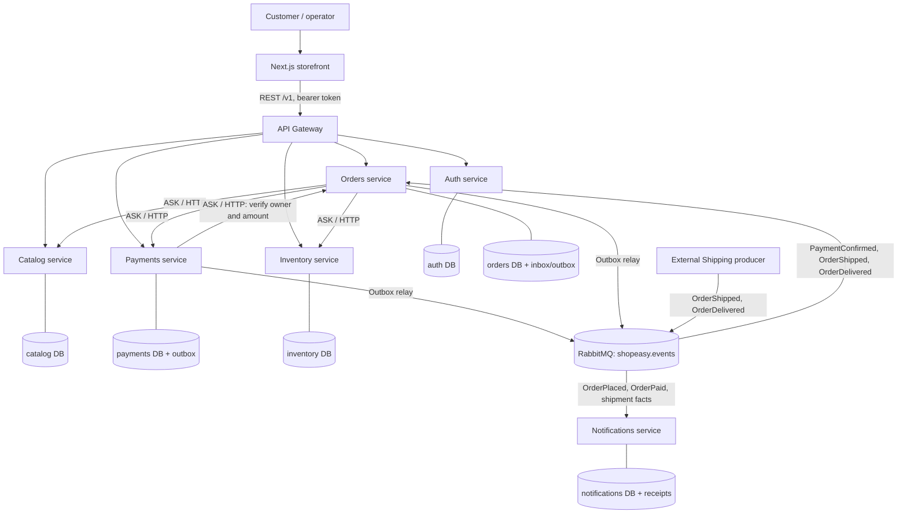
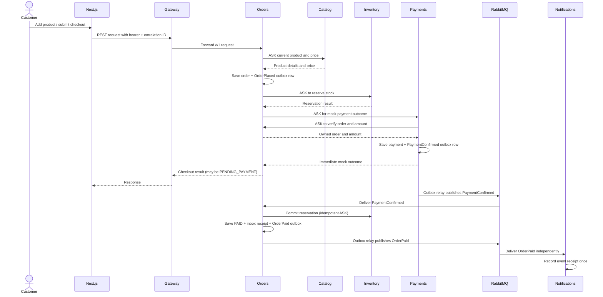

# ShopEasy architecture diagrams

## Components and communication

The six PostgreSQL databases are separate logical databases on the one local
PostgreSQL container. Each service connects only to its own database. The
arrows crossing a service boundary are HTTP requests or broker messages.

## Successful checkout sequence

Orders and Notifications subscribe to event queues independently. The
Notifications service records selected event receipts; no email delivery is
implemented. If the local mock returns `FAILED`, Orders releases the stock
reservation and cancels the order; `PaymentConfirmed` is not emitted.
