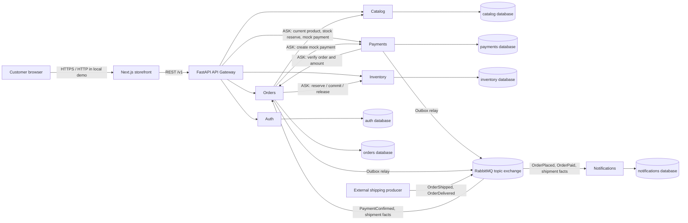

# ShopEasy architecture (as implemented)

ShopEasy is a learning storefront made from a Next.js web app and independently
running FastAPI services. The services use PostgreSQL for their own state and
RabbitMQ for asynchronous business facts. The browser uses one API Gateway.

## System diagram

The services use separate PostgreSQL databases and service credentials. Compose
runs one PostgreSQL server for convenience, but no service is given another
service's database URL. Arrows between contexts mean HTTP or RabbitMQ, never a
direct database query. `Shipping` is an external producer and is not a ShopEasy
service.

## Context ownership

| Context | Owns | Communication exposed in this project |
|---|---|---|
| Auth | Usernames, password hashes, and signed access-token issuance | Register, login, and current-user REST endpoints |
| Catalog | Product name/description, price, category, image URL, sellable state | Product/category REST endpoints; writes require an operator token |
| Orders | User-owned carts, checkout records, order line/price snapshots, and order status | Cart, checkout, order, and status REST endpoints; publishes `OrderPlaced`/`OrderPaid`; consumes payment/shipping facts |
| Payments | Payment attempts and idempotency records | Payment REST endpoints; uses a deterministic mock provider; publishes `PaymentConfirmed` |
| Inventory | On-hand quantity and stock reservations | Availability and internal reservation/stock REST endpoints |
| Notifications | Receipts for selected event IDs | Consumes order and shipment events and records them once; it does **not** send email |

There is no separate Cart, Shipping, or Pricing service. Orders owns carts;
Inventory owns stock; order lines keep a snapshot of the product name and price
accepted for the order.

## Request/reply and events

**ASK** means the caller needs an answer before continuing. For example, Orders
asks Catalog for current price, Inventory to reserve stock, and Payments for
the mock provider outcome during checkout. These use direct HTTP request/reply.
Payments also asks Orders to verify the order and amount before creating a
payment. The answer is needed to validate the payment request.

**TELL** means a service announces a fact that has already been committed. A
successful mock payment is stored by Payments with a `PaymentConfirmed` outbox
record. Its relay publishes the event later; Orders consumes it, commits the
reservation through Inventory, marks the order `PAID`, and records an
`OrderPaid` outbox event. Neither publisher waits for event subscribers.

Notifications consumes `OrderPlaced`, `OrderPaid`, `OrderShipped`, and
`OrderDelivered`, and stores receipts. Orders consumes `PaymentConfirmed`,
`OrderShipped`, and `OrderDelivered`. Shipment facts have schemas and consumers
here, but their producer is outside the repository.

## Boundaries and failure behavior

- The Gateway is the browser's single API entry point. It routes, checks bearer
  tokens, propagates correlation IDs, applies HTTP timeouts, and shapes gateway
  failures. Domain rules remain in the owning service.
- Each service only receives its own database URL and database credentials.
  SQLAlchemy models and sessions stay in the service package. Compose's shared
  PostgreSQL server is not a shared application database.
- Events are versioned past-tense facts. Delivery is at least once, so Orders
  and Notifications deduplicate event IDs in local receipt tables.
- Payments and Orders save critical outgoing events to an Outbox table in the
  same local transaction as the business change. A background relay publishes
  and only marks a record published after broker confirmation. A crash after
  broker acceptance can still create a duplicate; the stable event ID and
  consumer idempotency handle that case.
- Consumer transient failures use bounded delayed retries; permanent failures
  and exhausted retries go to a durable DLQ. The operator dashboard can inspect
  a sample. There is no automated replay feature.
- Synchronous HTTP calls have configured timeouts. Orders/Payments use an
  in-process circuit breaker for selected downstream calls. Checkout fails
  closed when it cannot confirm price, stock, or payment outcome.

See [the context map](context-map.md), [API contract guide](api-contracts.md),
[event contract guide](event-contracts.md), and [failure demonstration](demo-guide.md).
